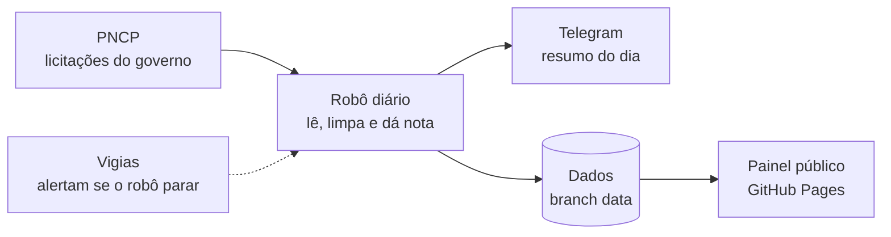
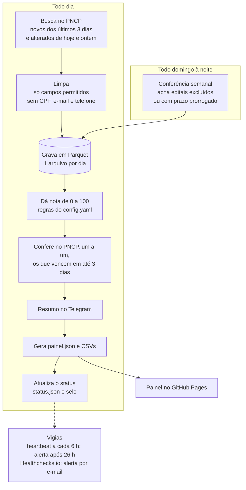

# Radar de Licitações PNCP

> Todo dia, um robô lê as licitações novas do governo, separa as que combinam com o perfil de uma empresa e avisa no Telegram. Os editais também ficam num painel público, com filtros.

[](https://github.com/victor-ozores/Radar-PNCP/actions/workflows/ci.yml)
[](https://github.com/victor-ozores/Radar-PNCP/actions/workflows/daily.yml)


### 👉 [Abrir o painel ao vivo](https://victor-ozores.github.io/Radar-PNCP/)

[](https://victor-ozores.github.io/Radar-PNCP/)

## Para que serve

O **PNCP** (Portal Nacional de Contratações Públicas) reúne as licitações do país, mas **não avisa ninguém**. Quem monta propostas acaba abrindo vários portais todo dia, ou descobre o edital tarde demais.

O Radar faz essa busca sozinho e entrega:

* 🆕 **Editais novos que combinam** com o perfil, com nota de 0 a 100 e o motivo da nota;
* ⏳ **Prazos chegando**: os que ainda dão tempo de montar a proposta;
* 🔎 **Um painel público** para consultar quando quiser, com busca e filtros.

> O perfil que vem no projeto é de **demonstração**: uma construtora de médio porte (obras e manutenção predial) em SP, RJ, MG e PR. O painel é um apoio, não uma recomendação: confira sempre o edital no PNCP.

## Como usar

| Quero... | Como |
|---|---|
| **Só olhar os editais** | Abra o [painel](https://victor-ozores.github.io/Radar-PNCP/). Filtre por estado, prazo (de uma data a outra) ou valor. Toque no **?** para ver o que cada termo quer dizer. Cada edital leva ao PNCP. |
| **Receber o resumo no Telegram** | Faça uma cópia do projeto e crie o seu bot (uns 20 minutos, sem custo): [passo a passo](docs/setup-checklist.md). |
| **Mudar o que o robô procura** | Edite o [`config.yaml`](config.yaml): estados, modalidades, palavras e faixa de valor. Não precisa mexer em código. |

## O que chega no Telegram

Exemplo no formato atual, com os dados reais de 22/10/2026 (recortado):

```
📡 Radar PNCP · 22/10/2026
87 editais novos combinam com o perfil, entre 812 novos lidos hoje. Os 10 que mais combinam:
🔎 Ver todos no painel

Combina muito · Execução da obra de construção do novo Fórum da Comarca de São João do Paraíso.
🏛 Tribunal de Justiça do Estado de Minas Gerais · 📍 Belo Horizonte / MG
💰 R$ 11,7 mi · 📄 Concorrência Eletrônica nº 627/2026
⏰ propostas até 16/11 09:00 (em 25 dias)
🔗 PNCP · sistema de origem

(...)

⏳ Prazos chegando (vencem em 2 a 7 dias)

Combina · Contratação de Empresa Especializada para Execução de Serviços de Calçamento em Estradas Vicinais do Município, com Fornecimento de Materiais e Mão de Obra.
🏛 Município de Brás Pires · 📍 Brás Pires / MG
💰 R$ 245 mil · 📄 Concorrência Eletrônica nº 05/2026
⏰ propostas até 26/10 07:59 (em 4 dias)
🔗 PNCP · sistema de origem
```

Como ler: **Combina muito** é nota 80 ou mais, **Combina** vai de 60 a 79 e **Combina em parte** de 40 a 59. Abaixo de 40 o robô não avisa.

## Como funciona



1. **Lê** o PNCP todo dia: os editais novos e os que mudaram (prazo prorrogado, suspensão, revogação).
2. **Dá uma nota** de 0 a 100 a cada um, pelas palavras e pela faixa de valor do `config.yaml`. Não usa IA: são regras que dá para auditar.
3. **Avisa** no Telegram e **atualiza o painel**.
4. **Se vigia**: se o robô deixar de rodar, um alerta chega pelo Telegram e outro por e-mail.

Agendado para 7h17, mas o GitHub tem entregado o horário com algumas horas de atraso (de 3 a 5,5 h); o resumo chega por volta do meio-dia.

## Custa R$ 0 e respeita a LGPD

* **Grátis:** GitHub (repositório público), API pública do PNCP, Telegram e Healthchecks.io (plano gratuito). Sem servidor e sem cartão.
* **Só dados públicos:** a fonte trata de órgãos e contratações, não de pessoas. CPF, e-mail e telefone que apareçam em texto livre são removidos antes de gravar.

## Quer ir mais fundo?

<details>
<summary><b>🔧 Detalhes técnicos</b> (fluxo completo, confiabilidade, decisões, como rodar)</summary>

### Fluxo completo



1. **Busca** as contratações publicadas nos últimos 3 dias (cobre fim de semana e agendamento atrasado) para as UFs e modalidades do `config.yaml`, e **também as alteradas** hoje e ontem, mesmo que publicadas meses antes.
2. **Limpa** cada registro: guarda só os campos de uma lista permitida e remove CPF, e-mail e telefone do texto livre.
3. **Grava** em Parquet particionado por dia. Rodar duas vezes a mesma janela não muda nenhum byte.
4. **Pontua** de 0 a 100 com regras do `config.yaml` e guarda o motivo de cada nota.
5. **Confere no PNCP**, um a um, os editais que combinam e vencem em até 3 dias (até 100 consultas, o que vence primeiro antes) e, antes de listar, os de "Prazos chegando" (até 15 consultas): o excluído ou prorrogado é corrigido e sai da lista.
6. **Avisa** no Telegram: novos relevantes, prazos que vencem em 2 a 7 dias (`alerta.prazo_minimo_dias`) e um aviso se alguma busca falhou.
7. **Publica** `export/painel.json` (só os abertos que combinam, com prazo em até 30 dias) e os CSVs na branch `data`. A página lê o `painel.json` direto do navegador.
8. **Registra** a execução em `pipeline_runs`, `status.json` e no selo do README.
9. **Todo domingo à noite** (19:47, também atrasa) roda a **conferência semanal**: relê as propostas abertas até 14 dias e consulta no PNCP, um a um (até 150), os editais que o robô guarda como abertos e a listagem não trouxe.

### Confiabilidade

* **Idempotência:** reexecutar a mesma janela não duplica nem altera dados (testado).
* **Falha parcial não derruba o dia:** se uma busca cai, as outras seguem; a execução fica `partial` e o alerta diz quais falharam.
* **Alerta de falha:** o workflow manda uma mensagem 🚨 com o link da execução. Se nem o pacote instalar, um `curl` de reserva avisa.
* **Heartbeat:** a cada 6 h um segundo workflow confere se a última execução **diária** bem-sucedida tem menos de 26 h. A conferência de domingo não conta, de propósito.
* **Vigia externo:** ao fim de cada execução diária bem-sucedida o robô acessa um endereço do [Healthchecks.io](https://healthchecks.io). Se o aviso não chegar (folga de 7 h), o próprio serviço alerta por e-mail, mesmo que o agendador do GitHub tenha parado junto com o heartbeat.
* **Agendamento vivo:** o GitHub desativa workflows agendados de repositórios públicos sem atividade por 60 dias; cada execução reabilita os dois.
* **Evidência pública:** histórico na aba *Actions* e `pipeline_runs.csv` na branch `data`.

### Decisões

| Decisão | Por quê |
|---|---|
| **DuckDB + Parquet**, sem arquivo `.duckdb` | SQL de verdade, custo zero, sem servidor. Parquet determinístico: reexecutar sem mudança não gera blobs novos no git |
| **Dados na branch `data`**, código na `main` | A `main` fica limpa e a história dos dados pode ser compactada (veja *Limpeza* abaixo) |
| **Intervalo de 4 s entre chamadas** e espera de 30/60/120 s no 429 | A API devolve 429 (corpo HTML) após ~8 a 10 chamadas rápidas; medido em 19/10/2026 |
| **Cliente isolado** em `pncp_client.py` | Só ele conhece URL e parâmetros; trocar de endpoint não espalha mudança |
| **Upsert por `numeroControlePNCP`** | Editais mudam de situação e de prazo depois de publicados |
| **Lê os alterados e confere no PNCP** | Só a listagem por publicação nunca revê um edital já guardado. Detalhes em [`docs/qualidade-dados-pncp.md`](docs/qualidade-dados-pncp.md) |
| **Edital repetido: junta, não esconde** | O órgão às vezes publica o mesmo edital duas vezes (mesmo órgão, valor, prazo e texto). Os dois registros existem no PNCP, então o robô os junta num item só (o publicado por último é o principal) e mostra o número e o link do outro. No alerta, cada registro é conferido antes, para o link nunca apontar para um edital excluído |
| **Nota por regras, explicável** | Cada nota vem com os motivos; dá para calibrar o perfil olhando o `--dry-run`. Regras firmes separam obra de compra, locação e serviço de escritório (consultoria, fiscalização, projeto); os casos reais estão em `tests/fixtures/casos_reais_filtro.json` |
| **Token do Telegram nunca vaza** | O token vai na URL da API; os logs do `httpx` ficam em WARNING e as mensagens de erro passam por filtro |
| **Texto da tela em caixa normal** | Só na exibição, igual no Telegram e na página (mesmas regras em Python e TypeScript, com testes dos dois lados). O texto guardado não muda |

### Limpeza da branch `data` (a cada 6 meses)

Medido em 19 a 22/10/2026: cada execução diária acrescenta de 0,4 a 3 MB comprimidos (o dia de 22/10 mexeu em 53 arquivos por causa das atualizações: 3 MB). Com ~3 MB por dia são ~1,1 GB por ano, acima dos 1 GB que o GitHub recomenda, e quem clona o repositório baixa a história inteira. Por isso a limpeza é **semestral**: ~550 MB no pior caso. Também vale limpar antes se o tamanho passar de ~500 MB (campo `size` da API do repositório). Passo a passo na seção 6 do [`docs/setup-checklist.md`](docs/setup-checklist.md).

### Stack

Python 3.11+ (testes locais em 3.13; o CI usa 3.12 em Ubuntu e Windows), `httpx`, `duckdb`, `pydantic`, `pyyaml`, `pytest`, `ruff`. GitHub Actions para agendar e para o CI. Telegram Bot API para alertas. Painel: React, TypeScript e Vite, animações com Motion, testes com Vitest, publicado no GitHub Pages.

### Estrutura do repositório

```
config.yaml            perfil de interesse e parâmetros
src/radar/
  pncp_client.py       HTTP, paginação, intervalo, retry
  normalize.py         JSON bruto -> linha plana, allowlist, remoção de PII, texto de leitura
  store.py             Parquet por dia + DuckDB, upsert idempotente
  scoring.py           nota 0-100 com motivos
  conferencia.py       consulta um edital no PNCP e corrige o que estiver velho
  repetidos.py         junta o edital que o órgão publicou duas vezes
  alerts/              montagem das mensagens e envio ao Telegram
  audit.py             pipeline_runs, status.json, badge.json
  export.py · painel.py   CSVs de dados abertos e o painel.json que a página lê
  heartbeat.py         vigia de "não rodou"
  pipeline.py · cli.py orquestração e linha de comando
site/                  a página do painel (React + Vite + TypeScript)
tests/                 pytest, com amostra real da API em tests/fixtures
queries/               exemplos de SQL
docs/                  passo a passo, achados sobre a API, metodologia de horas
.github/workflows/     daily.yml · heartbeat.yml · ci.yml · pages.yml
```

### Rodar no seu computador

```powershell
python -m venv .venv
.\.venv\Scripts\python.exe -m pip install -r requirements-dev.txt
.\.venv\Scripts\python.exe -m pip install -e . --no-deps
.\scripts\run_local.ps1 --dry-run     # prévia do alerta; não grava nem envia
```

Para receber o alerta no Telegram, siga o [passo a passo](docs/setup-checklist.md). No GitHub, o workflow **Pipeline diário** roda sozinho; também dá para disparar à mão com `modo` = `bootstrap` (carga inicial), `daily`, `reconcile` (conferência semanal) ou `backfill` (janela de datas).

Para ver a página no computador:

```powershell
.\scripts\run_local.ps1 --no-alerts              # gera data_local\export\painel.json, sem mandar Telegram
cd site
npm ci
Copy-Item ..\data_local\export\painel.json public\painel.json   # amostra local, fora do git
npm run dev
```

Testes e build como no CI: `npm run typecheck`, `npm test` e `npm run build` dentro de `site/`.

### Consultar os dados com SQL

```powershell
duckdb -c ".read queries/04_saude_do_pipeline.sql"
```

Há exemplos em [`queries/`](queries): editais abertos, volume por UF, qualidade dos dados e saúde do pipeline.

### O painel

* A página não tem servidor: baixa `export/painel.json` da branch `data` no navegador de quem abre e monta tudo ali. O workflow `pages.yml` só publica de novo quando o código da página muda.
* O prazo e o "faltam N dias" são refeitos no navegador a cada minuto, então o que venceu desde a última execução some sozinho.
* O cartão mostra o número do edital e, quando o órgão publicou o mesmo edital duas vezes, o número e o link do outro registro. Os números do painel contam cada edital uma vez.
* Valores abaixo de R$ 1 mil aparecem como "valor não informado" (existe R$ 0,04 nos dados reais). Os números valem só para as UFs e modalidades que o robô acompanha.
* Se o arquivo não carrega, a página explica e oferece tentar de novo; se ele tem uma versão que a página não conhece, pede para recarregar.
* O painel do robô mostra, como numa página de status de serviço, se ele está em dia, há quanto tempo atualizou, a taxa de sucesso dos últimos 30 dias, uma barra por rodada (as últimas 14; a altura e a legenda dizem se deu certo) e o que a última rodada fez, em quatro passos. Passa para "Atenção" quando faz mais de 36 horas sem atualizar.
* O "resumo de hoje" e a frase de cada gráfico saem dos próprios dados, não de texto fixo: se os números mudam, a frase muda junto (`site/src/lib/historia.ts`, com testes).
* Os termos técnicos têm um **?** com a explicação. Abre com o mouse, com o teclado (Tab) ou com o toque; Esc ou um novo toque fecha.
* Os filtros ficam numa coluna ao lado da lista e acompanham a rolagem no computador; no celular ficam atrás do botão "Filtrar".
* A página tem um tema só, escuro e suave, sem botão para trocar (cores conferidas para contraste e daltonismo). As animações respeitam a opção "reduzir movimento" do sistema.

### Indicadores e números medidos

Cada execução vira uma linha em `pipeline_runs`: início, fim, duração, status (`success`, `partial`, `failed`), janela, buscas e falhas, chamadas à API, 429, linhas lidas/novas/atualizadas/inválidas, prazos e situações corrigidos, relevantes novos, avisos de qualidade, alerta enviado e erro.

Até 22/10/2026 o robô rodou sozinho 3 vezes (20, 21 e 22/10), todas com sucesso. A de 22/10: 14 min, 129 chamadas à API, nenhum bloqueio 429, 2.143 editais lidos e 812 novos. **Horas economizadas** seguem como estimativa, com premissas ainda não validadas, em [`docs/metodologia-horas.md`](docs/metodologia-horas.md).

</details>

<details>
<summary><b>⚠️ Problemas que tivemos e limitações</b></summary>

### O que deu errado no caminho e o que foi feito

| O que aconteceu | O que foi feito |
|---|---|
| A API do PNCP bloqueia (erro 429) quem consulta rápido | Pausa de 4 s entre as chamadas e espera de 30, 60 e 120 s quando bloqueia. Desde então, nenhum bloqueio |
| O GitHub atrasa o horário agendado em algumas horas (medido de 3 h 09 a 5 h 25) | Aceito. O vigia externo tem 7 h de folga para não dar alarme falso |
| Prazos prorrogados (cerca de 1% dos editais que vencem em 7 dias) não apareciam | O robô lê também os editais alterados e, aos domingos, confere um a um no PNCP os que a listagem não confirma |
| Edital **excluído** do PNCP continuava no robô (2 de 837 em 22/10), e a lista de propostas do PNCP demora horas para mostrar uma exclusão ou prorrogação | Só a consulta individual vale. O robô a faz todo dia (os que combinam e vencem em até 3 dias), antes de cada alerta e todo domingo (até 14 dias): marca como "Excluída do PNCP" e tira das listas |
| O mesmo edital aparecia duas vezes (o órgão republica com outro número; cerca de 3% dos que combinam) | O painel e o Telegram mostram uma vez, com o número e o link do outro registro |
| "Aquisição de material" e "mão de obra" de limpeza apareciam como obra | Regras firmes de compra e locação; 70 casos reais viraram teste |
| Consultoria, fiscalização e projeto apareciam como obra (2,6% dos relevantes) | Regra de "serviço de escritório": nota zero, a menos que o texto peça também a execução |
| Valores simbólicos (R$ 0,04) | Abaixo de R$ 1 mil aparece "valor não informado" |
| Textos em CAIXA ALTA e nomes de cidade sem acento | Só na tela e no Telegram: caixa normal e a cidade como o edital a traz. O original continua no PNCP |
| O Power BI não atualiza sozinho na licença gratuita | Trocado por uma página no GitHub Pages |
| O histórico dos dados cresce de 0,4 a 3 MB por dia | Limpeza da branch `data` a cada 6 meses |

### Limitações conhecidas

* O perfil é de demonstração; os termos ainda não foram calibrados com uma pessoa de orçamentos.
* A nota olha só o texto do objeto e o valor, não entende o sentido. Numa amostra de 40 editais relevantes (21/10/2026), 39 estavam claramente certos e 1 era duvidoso; o julgamento foi do Claude, ainda não revisado por quem faz orçamentos. A faixa de nota 40 a 59 é mais ruidosa.
* O robô só vê as UFs e modalidades do `config.yaml` (hoje SP, RJ, MG e PR; concorrência e pregão). Dispensas de licitação ficam de fora até o volume ser medido. O estado é o do órgão, que pode não ser o local da obra.
* Obras abaixo de R$ 100 mil e acima de R$ 20 mi ficam fora, por desenho do perfil. Assuntos cujas palavras aparecem também fora de obra ("ponte", "drenagem", "esgotamento sanitário") foram testados e rejeitados por trazer lixo.
* "Fornecimento e instalação de..." conta como serviço, mas pode ser equipamento. Um serviço sem relação pode passar quando o nome da secretaria traz "Obras" ou "Engenharia" no meio do texto.
* A conferência semanal cobre prazos de até 14 dias e no máximo 150 editais por execução; o resto é visto quando a listagem trouxer. A carga inicial e a página cobrem prazos de até 30 dias.
* A página lê o arquivo direto do GitHub, que guarda uma cópia por até 5 minutos. Um prazo prorrogado só aparece depois da próxima execução; um edital que venceu some na hora.
* Se o robô ficar parado mais de 1 dia, as prorrogações desse intervalo só voltam na conferência de domingo ou com um `backfill`.

</details>

## Como foi feito

Construído com o **Claude Code**. O autor (Victor) definiu o problema, o público, as restrições (custo zero, repositório público, LGPD, Windows) e o perfil de interesse, e revisa o que é publicado. O Claude Code propôs a arquitetura, escreveu o código e os testes e validou o comportamento da API com chamadas reais, registrado em [`docs/qualidade-dados-pncp.md`](docs/qualidade-dados-pncp.md). A nota dos editais **não usa IA**.

## Licença

[MIT](LICENSE). Autor: Victor Amorim Ozores.
