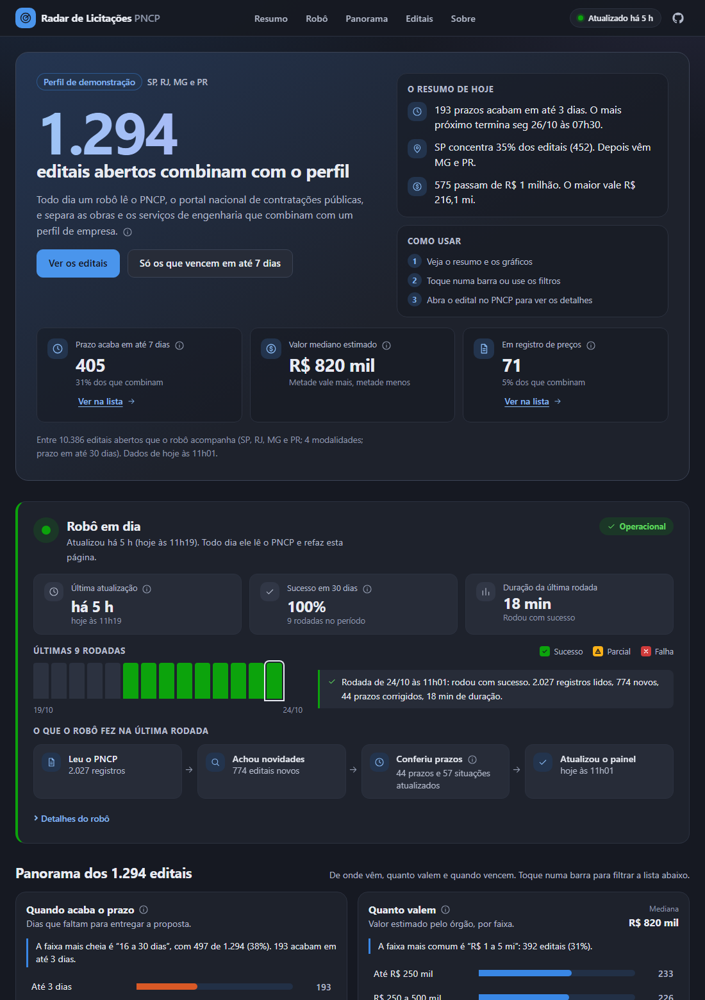
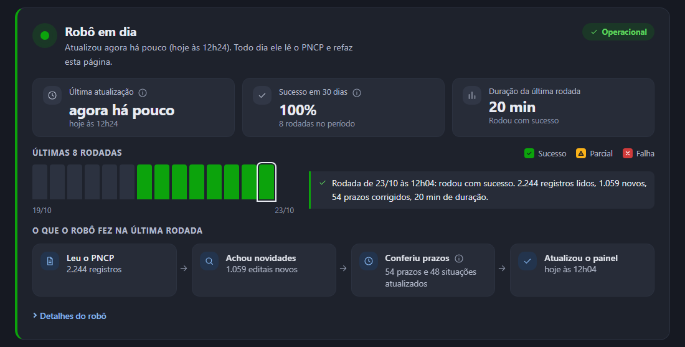
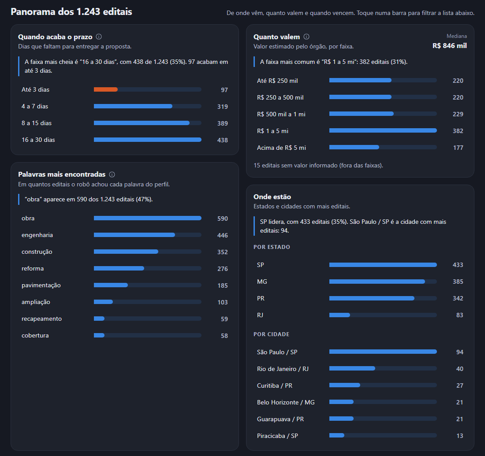
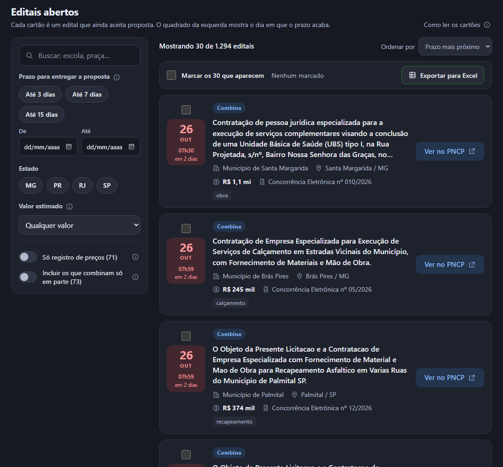
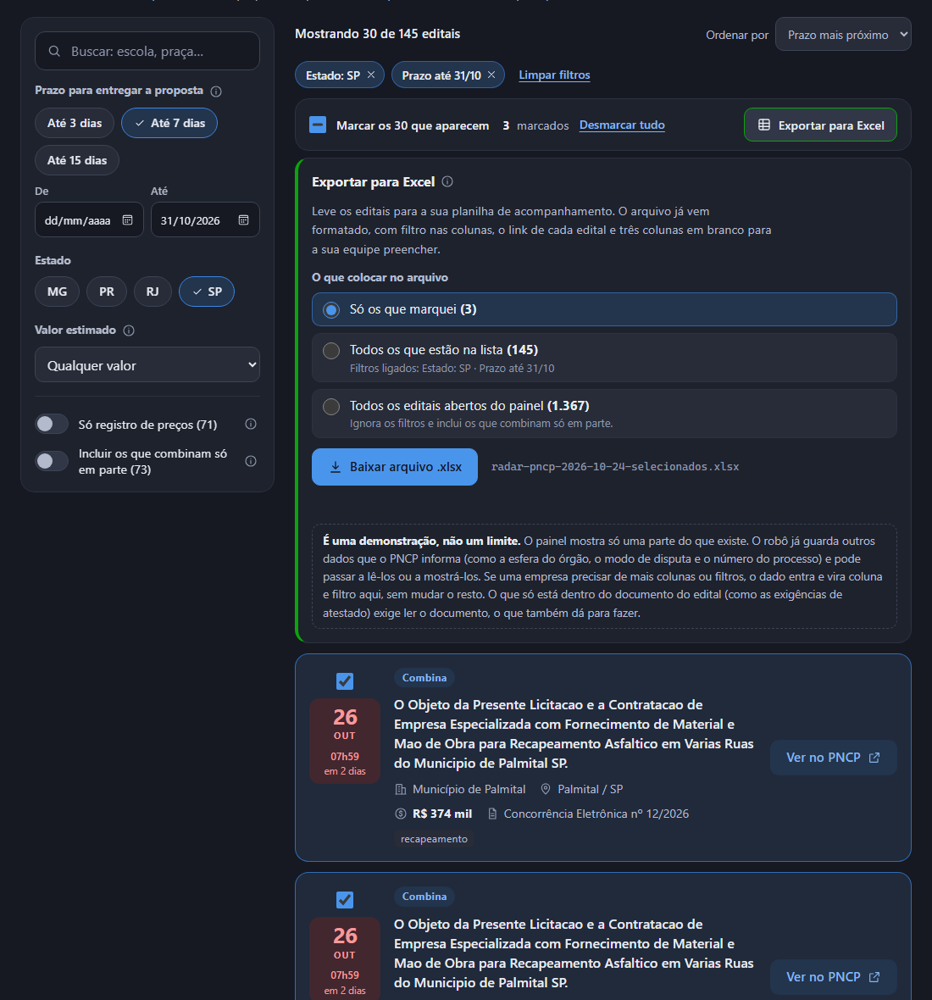
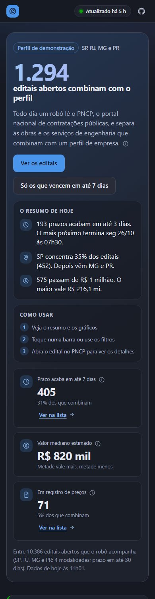
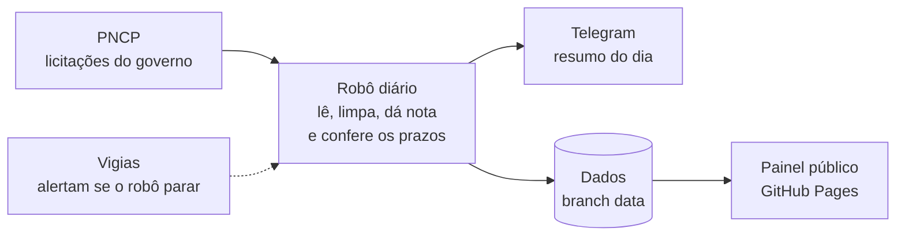
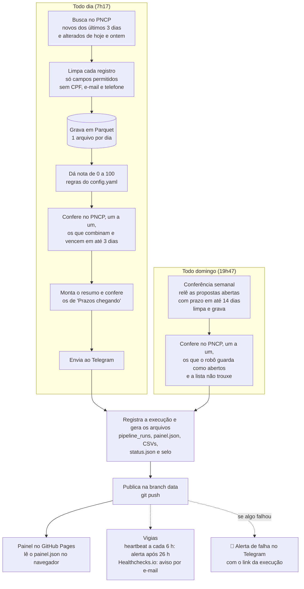

<div align="center">

</div>

<div align="center">

# 📡 Radar de Licitações PNCP

**Robô agendado que lê o PNCP todo dia, separa as obras e os serviços de engenharia que combinam com o perfil de uma empresa,
avisa no Telegram e alimenta um painel público com busca e filtros.**
Python + GitHub Actions + React, sem servidor e a custo zero.

[](https://victor-ozores.github.io/Radar-PNCP/)

&nbsp;

[](https://github.com/victor-ozores/Radar-PNCP)&nbsp;&nbsp;&nbsp;[](./LICENSE)&nbsp;&nbsp;&nbsp;

&nbsp;

[](https://github.com/victor-ozores/Radar-PNCP/actions/workflows/ci.yml)&nbsp;&nbsp;[](https://github.com/victor-ozores/Radar-PNCP/actions/workflows/daily.yml)&nbsp;&nbsp;

&nbsp;

[](https://linkedin.com/in/victor-ozores/)&nbsp;&nbsp;&nbsp;[](https://app.xperiun.com/in/victor-ozores-2)&nbsp;&nbsp;&nbsp;[](https://github.com/victor-ozores)

</div>

---

## 📌 Resumo

O **PNCP** (Portal Nacional de Contratações Públicas) reúne as licitações do país, mas **não avisa ninguém**. Quem monta propostas acaba abrindo vários portais todo dia, ou descobre o edital tarde demais.

O Radar faz essa busca sozinho: um robô agendado lê o PNCP, dá uma nota de 0 a 100 a cada edital, separa os que combinam com o perfil de uma empresa, avisa no Telegram e mantém um painel público com os que ainda estão abertos. Construí o projeto para mostrar, na prática, uma automação agendada de ponta a ponta: roda sozinha todos os dias, sem servidor e sem custo, e **avisa quando para de funcionar**.

**Resultado da execução de 23/10/2026:** 9.788 editais abertos acompanhados em SP, RJ, MG e PR, dos quais 1.317 passaram pelo filtro do perfil (1.243 combinam e 74 combinam só em parte). A rodada leu 2.244 registros do PNCP (1.059 novos) em 20 minutos, conferiu um a um 95 editais com prazo próximo (1 já estava excluído) e não teve nenhum bloqueio da API. Desde 20/10 o robô rodou sozinho 4 vezes (20, 21, 22 e 23/10), todas com sucesso.

> O perfil que vem no projeto é de **demonstração**: uma construtora de médio porte (obras e manutenção predial) em SP, RJ, MG e PR. [Veja abaixo exatamente o que ele considera.](#-qual-perfil-está-configurado) O painel é um apoio, não uma recomendação: confira sempre o edital no PNCP.

## 🔗 Ver Dashboard Online

[](https://victor-ozores.github.io/Radar-PNCP/)

Abre direto, sem login. A página não tem servidor: ela lê o arquivo que o robô grava a cada execução.

---

## 🎯 Qual Perfil Está Configurado

O robô procura o que uma empresa **fictícia** gostaria de disputar: uma **construtora de médio porte, de engenharia civil e manutenção predial**, inspirada no dia a dia do setor de orçamentos. Tudo isso fica no [`config.yaml`](config.yaml) e dá para trocar sem mexer em código. O painel e o Telegram mostram só o que combina com este perfil.

| O que o robô considera | Perfil de demonstração |
|---|---|
| **Estados** | SP, RJ, MG e PR (é o estado do órgão que publica o edital) |
| **Modalidades** | Concorrência (eletrônica e presencial) e pregão (eletrônico e presencial). Dispensa de licitação fica de fora |
| **Valor estimado** | De R$ 100 mil a R$ 20 milhões. Fora dessa faixa a nota cai; sem valor informado, o valor não conta nem a favor nem contra |
| **Prazo** | Só editais ainda abertos. O painel mostra os que vencem em até 30 dias |
| **Palavras que o robô procura** (valem mais) | obra, reforma, construção, edificação, engenharia, manutenção predial, instalações elétricas e hidráulicas, climatização, impermeabilização, pavimentação, recapeamento, calçamento, demolição, restauro, ampliação, muro, terraplenagem, rede coletora |
| **Palavras que ajudam menos** | ar-condicionado, elevador, pintura, hidráulica, gerador, subestação, para-raios, extintor, telhado, cobertura, piso, esquadria, calçada |
| **Palavras que derrubam a nota** | medicamento, uniforme, merenda, material de escritório, combustível, passagem aérea, pneu, material hospitalar, exame laboratorial, informática, drone, aquisição… |
| **O que fica de fora, de propósito** | **Compra e locação** (o texto pede aquisição, fornecimento ou locação) e **serviço de escritório** (consultoria, fiscalização, projeto) sem execução de obra. Esses recebem nota zero |

**Como a nota de 0 a 100 é somada:** cada palavra forte vale +35 (até 70) e cada palavra fraca +8 (até 16); palavra que derruba tira 40; o estado dá de +6 a +10 (SP +10, RJ e MG +8, PR +6); concorrência dá +10 e pregão +5; valor dentro da faixa dá +15 e fora tira 15. A soma é limitada entre 0 e 100. De 80 para cima é **Combina muito**, de 60 a 79 é **Combina**, de 40 a 59 é **Combina em parte**, e abaixo de 40 o edital não entra.

Dois exemplos, calculados pelo próprio robô:

| Edital | Conta | Resultado |
|---|---|---|
| "Execução da obra de construção do novo Fórum da Comarca de São João do Paraíso" (MG, concorrência eletrônica, R$ 11,7 mi) | obra + construção +70, MG +8, concorrência +10, valor na faixa +15 = 103, limitado a 100 | **Combina muito** |
| "Contratação de empresa para pintura e troca de telhado da escola municipal" (SP, pregão eletrônico, R$ 180 mil; texto de exemplo) | pintura + telhado +16, SP +10, pregão +5, valor na faixa +15 = 46 | **Combina em parte** |

Os termos ainda não foram calibrados com quem faz orçamentos de verdade (veja as limitações). Para outro perfil, edite o `config.yaml` e confira a prévia com `--dry-run`, sem enviar nada.

## 💡 O Que Ele Responde

* Quais editais abertos **combinam com o perfil** e quais olhar primeiro (nota de 0 a 100, com o motivo da nota)?
* Quais **vencem esta semana** e ainda dão tempo de montar a proposta?
* **Onde estão** (estado e cidade), **quanto valem** e **em que prazo** vencem?
* O mesmo edital foi publicado duas vezes? O painel mostra uma vez e indica o outro número.
* **O robô está funcionando?** O painel mostra há quanto tempo atualizou e como foram as últimas rodadas.
* Como levar os editais para a **planilha de acompanhamento** da equipe? Marque os que interessam, ou exporte tudo o que está filtrado, para um arquivo do Excel já formatado.

## 🧭 Como Usar

| Quero... | Como |
|---|---|
| **Só olhar os editais** | Abra o [painel](https://victor-ozores.github.io/Radar-PNCP/). Filtre por estado, prazo (de uma data a outra) ou valor. Toque no **?** para ver o que cada termo quer dizer. Cada edital leva ao PNCP. |
| **Levar os editais para o Excel** | Na lista, marque os editais (ou use **Marcar todos os N da lista**) e clique em **Exportar para Excel**. Escolha entre só os marcados, todos os que estão no filtro ou todos os do painel. O arquivo `.xlsx` já vem formatado. |
| **Receber o resumo no Telegram** | Faça uma cópia do projeto e crie o seu bot (uns 20 minutos, sem custo): [passo a passo](docs/setup-checklist.md). |
| **Mudar o que o robô procura** | Edite o [`config.yaml`](config.yaml): estados, modalidades, palavras e faixa de valor. Não precisa mexer em código. |

## 📊 Seções do Painel

| Seção | O que mostra |
|---|---|
| **Resumo** | Quantos editais abertos combinam com o perfil, o resumo do dia (prazos, estados e valores, escrito a partir dos próprios dados) e atalhos para os que vencem em até 7 dias |
| **Robô em dia** | Painel de status do robô: se está em dia, há quanto tempo atualizou, taxa de sucesso, uma barra por rodada (as últimas 14) e o que a última rodada fez |
| **Panorama** | Quatro gráficos que filtram a lista ao toque: prazo, valor, palavras do perfil e onde estão (estados e cidades) |
| **Editais abertos** | Lista com busca e filtros (estado, prazo, valor, registro de preços). Cada cartão leva ao edital no PNCP e tem uma caixa para marcar. Acima da lista, **Exportar para Excel** |
| **Antes de usar** | Os avisos que importam (perfil de demonstração, confira no PNCP) e como o painel é calculado |

## 🧩 É Uma Demonstração, Não Um Limite

O painel e o arquivo do Excel mostram **só uma parte do que existe**. Para outro uso, o caminho é sempre o mesmo e não exige refazer o projeto:

| De onde vem o dado | Exemplos | O que seria preciso |
|---|---|---|
| **Já aparece hoje** | órgão, estado, cidade, modalidade, número, valor, registro de preços, prazo, nota, palavras, link | nada |
| **O robô já guarda, mas o painel ainda não mostra** | esfera do órgão (federal, estadual ou municipal), poder, modo de disputa, número do processo, amparo legal, unidade, data de publicação | levar o campo até o painel: vira coluna no Excel e filtro na lista |
| **O PNCP informa, mas o robô ainda não lê** | outros campos da contratação | passar a ler o campo na busca, guardar e mostrar |
| **Só está dentro do documento do edital** | exigências de atestado, planilhas, anexos | ler os documentos do edital (arquivos PDF): dá para fazer, é um trabalho maior |

Se uma empresa pedir outro filtro ou outra coluna, o dado entra e passa a aparecer. A lista de colunas do Excel e a lista de filtros são montadas a partir de listas simples no código, então acrescentar uma é uma mudança localizada.

## 📸 Preview

<div align="center">

<br><br>

<br><br>

<br><br>

<br><br>

</div>

## 📲 O que chega no Telegram

Exemplo no formato atual, com os dados reais de 22/10/2026 (recortado):

```
📡 Radar PNCP · 22/10/2026
87 editais novos combinam com o perfil, entre 812 novos lidos hoje. Os 10 que mais combinam:
🔎 Ver todos no painel

Combina muito · Execução da obra de construção do novo Fórum da Comarca de São João do Paraíso.
🏛 Tribunal de Justiça do Estado de Minas Gerais · 📍 Belo Horizonte / MG
💰 R$ 11,7 mi · 📄 Concorrência Eletrônica nº 627/2026
⏰ propostas até 16/11 09:00 (em 25 dias)
🔗 PNCP · sistema de origem

(...)

⏳ Prazos chegando (vencem em 2 a 7 dias)

Combina · Contratação de Empresa Especializada para Execução de Serviços de Calçamento em Estradas Vicinais do Município, com Fornecimento de Materiais e Mão de Obra.
🏛 Município de Brás Pires · 📍 Brás Pires / MG
💰 R$ 245 mil · 📄 Concorrência Eletrônica nº 05/2026
⏰ propostas até 26/10 07:59 (em 4 dias)
🔗 PNCP · sistema de origem
```

Como ler: **Combina muito** é nota 80 ou mais, **Combina** vai de 60 a 79 e **Combina em parte** de 40 a 59. Abaixo de 40 o robô não avisa.

## ⚙️ Como Funciona



1. **Lê** o PNCP todo dia: os editais novos e os que mudaram (prazo prorrogado, suspensão, revogação).
2. **Dá uma nota** de 0 a 100 a cada um, pelas palavras e pela faixa de valor do `config.yaml`. Não usa IA: são regras que dá para auditar.
3. **Confere** no PNCP, um a um, os que vencem logo, para não mostrar prazo velho nem edital excluído.
4. **Avisa** no Telegram e **atualiza o painel**.
5. **Se vigia**: se o robô deixar de rodar, um alerta chega pelo Telegram e outro por e-mail.

Agendado para 7h17, mas o GitHub tem entregado o horário com algumas horas de atraso (de 3 a 5,5 h); o resumo chega por volta do meio-dia.

## 💰 Custa R$ 0 e Respeita a LGPD

* **Grátis:** GitHub (repositório público), API pública do PNCP, Telegram e Healthchecks.io (plano gratuito). Sem servidor e sem cartão.
* **Só dados públicos:** a fonte trata de órgãos e contratações, não de pessoas. CPF, e-mail e telefone que apareçam em texto livre são removidos antes de gravar.

<details>
<summary><b>⚙️ Detalhes Técnicos</b> (fluxo completo, confiabilidade, decisões, como rodar)</summary>

### Fluxo completo



1. **Busca** as contratações publicadas nos últimos 3 dias (cobre fim de semana e agendamento atrasado) para as UFs e modalidades do `config.yaml`, e **também as alteradas** hoje e ontem, mesmo que publicadas meses antes.
2. **Limpa** cada registro: guarda só os campos de uma lista permitida e remove CPF, e-mail e telefone do texto livre.
3. **Grava** em Parquet particionado por dia. Rodar duas vezes a mesma janela não muda nenhum byte.
4. **Pontua** de 0 a 100 com regras do `config.yaml`; os motivos de cada nota vão para o `editais.csv`.
5. **Confere no PNCP**, um a um, os editais que combinam e vencem em até 3 dias (até 100 consultas, o que vence primeiro antes) e, antes de listar, os de "Prazos chegando" (até 15 consultas): o excluído ou prorrogado é corrigido e sai da lista. Se o PNCP para de responder, as duas conferências desistem sem marcar nada.
6. **Avisa** no Telegram: novos relevantes, prazos que vencem em 2 a 7 dias (`alerta.prazo_minimo_dias`) e um aviso se alguma busca falhou.
7. **Registra e gera os arquivos**: a execução entra em `pipeline_runs`, e saem o `export/painel.json` (os abertos que combinam, com prazo em até 30 dias), os CSVs, o `status.json` e o selo. Isso acontece mesmo quando alguma etapa falha, para a falha ficar registrada.
8. **Publica** esses arquivos na branch `data`. A página lê o `painel.json` direto do navegador. Ao fim de uma rotina diária bem-sucedida, o robô avisa o Healthchecks.io.
9. **Todo domingo à noite** (19:47, também atrasa) roda a **conferência semanal**: relê as propostas abertas até 14 dias e consulta no PNCP, um a um (até 150), os editais que o robô guarda como abertos e a listagem não trouxe. Ela não manda mensagem no Telegram; segue direto para o passo 7.

### Confiabilidade

* **Idempotência:** reexecutar a mesma janela não duplica nem altera dados (testado).
* **Falha parcial não derruba o dia:** se uma busca cai, as outras seguem; a execução fica `partial` e o alerta diz quais falharam.
* **Alerta de falha:** o workflow manda uma mensagem 🚨 com o link da execução. Se nem o pacote instalar, um `curl` de reserva avisa.
* **Heartbeat:** a cada 6 h um segundo workflow confere se a última execução **diária** bem-sucedida tem menos de 26 h. A conferência de domingo não conta, de propósito.
* **Vigia externo:** ao fim de cada execução diária bem-sucedida o robô acessa um endereço do [Healthchecks.io](https://healthchecks.io). Se o aviso não chegar (folga de 7 h), o próprio serviço alerta por e-mail, mesmo que o agendador do GitHub tenha parado junto com o heartbeat.
* **Agendamento vivo:** o GitHub desativa workflows agendados de repositórios públicos sem atividade por 60 dias; cada execução reabilita os dois.
* **Evidência pública:** histórico na aba *Actions* e `pipeline_runs.csv` na branch `data`.

### Decisões

| O que decidi | Por quê |
|---|---|
| Usar **DuckDB + Parquet**, sem arquivo `.duckdb` | SQL de verdade, custo zero, sem servidor. Parquet determinístico: reexecutar sem mudança não gera blobs novos no git |
| Guardar os **dados na branch `data`** e o código na `main` | A `main` fica limpa e a história dos dados pode ser compactada (veja *Limpeza* abaixo) |
| **Intervalo de 4 s entre chamadas** e espera de 30/60/120 s no 429 | A API devolve 429 (corpo HTML) após ~8 a 10 chamadas rápidas; medido em 19/10/2026 |
| Isolar o **cliente da API** em `pncp_client.py` | Só ele conhece URL e parâmetros; trocar de endpoint não espalha mudança |
| Gravar por **upsert** em `numeroControlePNCP` | Editais mudam de situação e de prazo depois de publicados |
| **Ler os alterados e conferir no PNCP** | Só a listagem por publicação nunca revê um edital já guardado. Detalhes em [`docs/qualidade-dados-pncp.md`](docs/qualidade-dados-pncp.md) |
| **Juntar o edital repetido**, não esconder | O órgão às vezes publica o mesmo edital duas vezes (mesmo órgão, valor, prazo e texto). Os dois registros existem no PNCP, então o robô os junta num item só (o publicado por último é o principal) e mostra o número e o link do outro. No alerta, cada registro é conferido antes, para o link nunca apontar para um edital excluído |
| Dar a nota por **regras que se explicam**, sem IA | Cada nota vem com os motivos; dá para calibrar o perfil olhando o `--dry-run`. Regras firmes separam obra de compra, locação e serviço de escritório (consultoria, fiscalização, projeto); os casos reais estão em `tests/fixtures/casos_reais_filtro.json` |
| Nunca deixar o **token do Telegram** vazar | O token vai na URL da API; os logs do `httpx` ficam em WARNING e as mensagens de erro passam por filtro |
| Escrever o **texto em caixa normal** só na tela | Igual no Telegram e na página (mesmas regras em Python e TypeScript, com testes dos dois lados). O texto guardado não muda |
| Deixar a pessoa **escolher o que vai para o Excel**: só os marcados, todos os da lista ou todos os do painel | Empresa quer ora três editais, ora tudo o que filtrou por data e estado. Marcar é opcional: dá para exportar o filtro inteiro sem marcar nada, e "Marcar todos os N da lista" vale até para o que ainda não aparece na tela |
| Mandar o **texto inteiro** do objeto no `painel.json` só quando o resumo cortou | A lista precisa de um resumo, mas quem leva o edital para a planilha precisa do texto todo: 61% dos editais chegavam cortados com "…". Mandar sempre o texto inteiro engordaria o arquivo à toa; assim só vai quando faz diferença |
| Gerar o arquivo **.xlsx já formatado**, com a biblioteca `write-excel-file`, carregada só quando se pede o arquivo | Comparei com a `exceljs`: ela tem mais recursos, mas pesa 256 KB compactados (esta, 20 KB) e deixa 2 alertas no `npm audit` (dependência `uuid`); esta tem zero alertas e foi atualizada em 2026. O filtro nas colunas e a lista de opções da coluna "Situação" não vêm nela: coloquei por conta própria, na ordem de elementos que o formato exige, com teste e conferência do arquivo em outro leitor |
| Fazer o painel como **página própria** (GitHub Pages), e não em Power BI | O Power BI não atualiza sozinho na licença gratuita. A página lê o arquivo que o robô grava e se atualiza sem ninguém abrir nada |
| Mostrar **um tema só**, escuro e suave | Dois temas custam mais código e mais processamento no navegador; as cores têm contraste e daltonismo conferidos |

### Limpeza da branch `data` (a cada 6 meses)

Medido em 19 a 22/10/2026: cada execução diária acrescenta de 0,4 a 3 MB comprimidos (o dia de 22/10 mexeu em 53 arquivos por causa das atualizações: 3 MB). Com ~3 MB por dia são ~1,1 GB por ano, acima dos 1 GB que o GitHub recomenda, e quem clona o repositório baixa a história inteira. Por isso decidi fazer a limpeza **a cada 6 meses**: ~550 MB no pior caso. Também vale limpar antes se o tamanho passar de ~500 MB (campo `size` da API do repositório). Passo a passo na seção 6 do [`docs/setup-checklist.md`](docs/setup-checklist.md).

### Stack

Python 3.11+ (testes locais em 3.13; o CI usa 3.12 em Ubuntu e Windows), `httpx`, `duckdb`, `pydantic`, `pyyaml`, `pytest`, `ruff`. GitHub Actions para agendar e para o CI. Telegram Bot API para alertas. Painel: React, TypeScript e Vite, animações com Motion, arquivo do Excel com `write-excel-file`, testes com Vitest, publicado no GitHub Pages.

### Estrutura do repositório

```
config.yaml            perfil de interesse e parâmetros
src/radar/
  pncp_client.py       HTTP, paginação, intervalo, retry
  normalize.py         JSON bruto -> linha plana, allowlist, remoção de PII, texto de leitura
  store.py             Parquet por dia + DuckDB, upsert idempotente
  scoring.py           nota 0-100 com motivos
  conferencia.py       consulta um edital no PNCP e corrige o que estiver velho
  repetidos.py         junta o edital que o órgão publicou duas vezes
  alerts/              montagem das mensagens e envio ao Telegram
  audit.py             pipeline_runs, status.json, badge.json
  export.py · painel.py   CSVs de dados abertos e o painel.json que a página lê
  heartbeat.py         vigia de "não rodou"
  pipeline.py · cli.py orquestração e linha de comando
site/                  a página do painel (React + Vite + TypeScript)
tests/                 pytest, com amostra real da API em tests/fixtures
queries/               exemplos de SQL
docs/                  passo a passo, achados sobre a API, metodologia de horas
.github/workflows/     daily.yml · heartbeat.yml · ci.yml · pages.yml
```

### Rodar no seu computador

```powershell
python -m venv .venv
.\.venv\Scripts\python.exe -m pip install -r requirements-dev.txt
.\.venv\Scripts\python.exe -m pip install -e . --no-deps
.\scripts\run_local.ps1 --dry-run     # prévia do alerta; não grava nem envia
```

Para receber o alerta no Telegram, siga o [passo a passo](docs/setup-checklist.md). No GitHub, o workflow **Pipeline diário** roda sozinho; também dá para disparar à mão com `modo` = `bootstrap` (carga inicial), `daily`, `reconcile` (conferência semanal) ou `backfill` (janela de datas).

Para ver a página no computador:

```powershell
.\scripts\run_local.ps1 --no-alerts              # gera data_local\export\painel.json, sem mandar Telegram
cd site
npm ci
Copy-Item ..\data_local\export\painel.json public\painel.json   # amostra local, fora do git
npm run dev
```

Testes e build como no CI: `npm run typecheck`, `npm test` e `npm run build` dentro de `site/`.

### Consultar os dados com SQL

```powershell
duckdb -c ".read queries/04_saude_do_pipeline.sql"
```

Há exemplos em [`queries/`](queries): editais abertos, volume por UF, qualidade dos dados e saúde do pipeline.

### O painel

* A página não tem servidor: baixa `export/painel.json` da branch `data` no navegador de quem abre e monta tudo ali. O workflow `pages.yml` só publica de novo quando o código da página muda.
* O prazo e o "faltam N dias" são refeitos no navegador a cada minuto, então o que venceu desde a última execução some sozinho.
* O cartão mostra o número do edital e, quando o órgão publicou o mesmo edital duas vezes, o número e o link do outro registro. Os números do painel contam cada edital uma vez.
* Valores abaixo de R$ 1 mil aparecem como "valor não informado" (existe R$ 0,04 nos dados reais). Os números valem só para as UFs e modalidades que o robô acompanha.
* Se o arquivo não carrega, a página explica e oferece tentar de novo; se ele tem uma versão que a página não conhece, pede para recarregar.
* O painel do robô mostra, como numa página de status de serviço, se ele está em dia, há quanto tempo atualizou, a taxa de sucesso dos últimos 30 dias, uma barra por rodada (as últimas 14; a altura e a legenda dizem se deu certo) e o que a última rodada fez, em quatro passos. Passa para "Atenção" quando faz mais de 36 horas sem atualizar.
* O "resumo de hoje" e a frase de cada gráfico saem dos próprios dados, não de texto fixo: se os números mudam, a frase muda junto (`site/src/lib/historia.ts`, com testes).
* Os termos técnicos têm um **?** com a explicação. Abre com o mouse, com o teclado (Tab) ou com o toque; Esc ou um novo toque fecha.
* Os filtros ficam numa coluna ao lado da lista e acompanham a rolagem no computador; no celular ficam atrás do botão "Filtrar".
* Cada cartão tem uma caixa de marcar. "Marcar os 30 que aparecem" marca a página; quando há mais, aparece "Marcar todos os N da lista" (como num e-mail). O que foi marcado continua marcado mesmo que o filtro mude.
* A página tem um tema só, escuro e suave, sem botão para trocar. As animações respeitam a opção "reduzir movimento" do sistema.

### O arquivo do Excel

* **Aba "Editais"**, uma linha por edital: prazo (data e hora de verdade, no horário de Brasília), quantos dias faltam, se combina, **nota de 0 a 100** (um número, para ordenar por relevância), **objeto inteiro** (em caixa normal), órgão, estado, município, modalidade, número, valor estimado (número, formatado em R$), registro de preços, palavras do perfil, "também publicado como" e o link do PNCP (clicável).
* **Três colunas verdes em branco** para a equipe: *Situação* (com lista de opções: Analisar, Vou disputar, Descartado, Proposta enviada, Ganhou, Perdeu), *Responsável* e *Observações*.
* **Formatação:** cabeçalho fixo, filtro em cada coluna, largura ajustada, linhas finas, e a coluna "Faltam (dias)" em vermelho até 2 dias e amarelo até 7, as mesmas cores da lista.
* **Aba "Sobre este arquivo"**: quando foi gerado, de quando são os dados, o que foi exportado, os filtros que estavam ligados na tela (e se eles valem ou não para o arquivo: só valem quando a escolha foi "todos os da lista"), o perfil usado, como se lê a nota e o aviso de que é uma demonstração.
* **Texto inteiro:** a lista da página mostra só um resumo do objeto (220 letras), mas o Excel leva o texto todo. Por isso o robô manda o texto inteiro no `painel.json` quando o resumo cortou alguma coisa (campos `objeto_completo` e `orgao_completo`; sem corte, o campo nem existe). Eram 61% dos editais; o arquivo foi de 0,84 para 1,19 MB (de 167 para 231 KB compactados).
* **Link que aparece em qualquer lugar:** o link é uma fórmula do Excel e, por isso, o texto "Abrir no PNCP" vai guardado junto dela. Sem isso, o arquivo baixado da internet, que o Excel abre em "Modo de Exibição Protegido" sem recalcular, mostraria a coluna vazia até a pessoa habilitar a edição.
* **Como é feito:** a página monta o arquivo no navegador de quem clicou, sem servidor. A biblioteca só é baixada nesse momento (a página não fica mais pesada para quem só olha a lista). O código está em `site/src/lib/exportar.ts` (o que entra e como cada edital vira uma linha) e `site/src/lib/excel.ts` (o arquivo). Para acrescentar uma coluna, é uma linha na lista `COLUNAS` (foi assim que entrou a Nota).
* **Como foi conferido:** testes automáticos, e uma conferência no navegador de verdade: marcar, filtrar e baixar os quatro tipos de arquivo, e abrir cada um com outro leitor (openpyxl) para comparar número de linhas, links (e o texto guardado neles), notas, objetos inteiros, ordem, formatos, filtro, lista de opções e a ordem dos elementos do arquivo. O Excel em si não foi aberto nesta máquina.

### Indicadores e números medidos

Cada execução vira uma linha em `pipeline_runs`: início, fim, duração, status (`success`, `partial`, `failed`), janela, buscas e falhas, chamadas à API, 429, linhas lidas/novas/atualizadas/inválidas, prazos e situações corrigidos, relevantes novos, avisos de qualidade, alerta enviado e erro.

Até 23/10/2026 o robô rodou sozinho 4 vezes (20, 21, 22 e 23/10), todas com sucesso. A de 23/10, a primeira com a conferência diária dos que vencem logo: 20 min, 228 chamadas à API, nenhum bloqueio 429, 2.244 editais lidos e 1.059 novos. A de 22/10 levou 14 min, com 129 chamadas. **Horas economizadas** seguem como estimativa, com premissas ainda não validadas, em [`docs/metodologia-horas.md`](docs/metodologia-horas.md).

</details>

<details>
<summary><b>⚠️ Problemas que Apareceram e Limitações</b></summary>

### O que deu errado no caminho e o que fiz

| O que aconteceu | O que fiz |
|---|---|
| A API do PNCP bloqueia (erro 429) quem consulta rápido | Pausa de 4 s entre as chamadas e espera de 30, 60 e 120 s quando bloqueia. Desde então, nenhum bloqueio |
| O GitHub atrasa o horário agendado em algumas horas (medido de 3 h 09 a 5 h 25) | Aceitei o atraso. O vigia externo tem 7 h de folga para não dar alarme falso |
| Prazos prorrogados (cerca de 1% dos editais que vencem em 7 dias) não apareciam | O robô lê também os editais alterados e, aos domingos, confere um a um no PNCP os que a listagem não confirma |
| Edital **excluído** do PNCP continuava no robô (2 de 837 em 22/10), e a lista de propostas do PNCP demora horas para mostrar uma exclusão ou prorrogação | Só a consulta individual vale. O robô a faz todo dia (os que combinam e vencem em até 3 dias), antes de cada alerta e todo domingo (até 14 dias): marca como "Excluída do PNCP" e tira das listas |
| O mesmo edital aparecia duas vezes (o órgão republica com outro número; cerca de 3% dos que combinam) | O painel e o Telegram mostram uma vez, com o número e o link do outro registro |
| "Aquisição de material" e "mão de obra" de limpeza apareciam como obra | Regras firmes de compra e locação; 70 casos reais viraram teste |
| Consultoria, fiscalização e projeto apareciam como obra (2,6% dos relevantes) | Regra de "serviço de escritório": nota zero, a menos que o texto peça também a execução |
| Valores simbólicos (R$ 0,04) | Abaixo de R$ 1 mil aparece "valor não informado" |
| Textos em CAIXA ALTA e nomes de cidade sem acento | Só na tela e no Telegram: caixa normal e a cidade como o edital a traz. O original continua no PNCP |
| O histórico dos dados cresce de 0,4 a 3 MB por dia | Limpeza da branch `data` a cada 6 meses |

### Limitações conhecidas

* O perfil é de demonstração; os termos ainda não foram calibrados com uma pessoa de orçamentos.
* A nota olha só o texto do objeto e o valor, não entende o sentido. Numa amostra de 40 editais relevantes (21/10/2026), 39 estavam claramente certos e 1 era duvidoso; essa conferência ainda não foi revisada por quem faz orçamentos. A faixa de nota 40 a 59 é mais ruidosa.
* O robô só vê as UFs e modalidades do `config.yaml` (hoje SP, RJ, MG e PR; concorrência e pregão). Dispensas de licitação ficam de fora até o volume ser medido. O estado é o do órgão, que pode não ser o local da obra.
* Obras abaixo de R$ 100 mil e acima de R$ 20 mi ficam fora, por desenho do perfil. Assuntos cujas palavras aparecem também fora de obra ("ponte", "drenagem", "esgotamento sanitário") foram testados e rejeitados por trazer lixo.
* "Fornecimento e instalação de..." conta como serviço, mas pode ser equipamento. Um serviço sem relação pode passar quando o nome da secretaria traz "Obras" ou "Engenharia" no meio do texto.
* A conferência semanal cobre prazos de até 14 dias e no máximo 150 editais por execução; o resto é visto quando a listagem trouxer. A carga inicial e a página cobrem prazos de até 30 dias.
* A página lê o arquivo direto do GitHub, que guarda uma cópia por até 5 minutos. Um prazo prorrogado só aparece depois da próxima execução; um edital que venceu some na hora.
* Se o robô ficar parado mais de 1 dia, as prorrogações desse intervalo só voltam na conferência de domingo ou com um `backfill`.

</details>

## 🛠️ Como Foi Feito

Projeto meu, de ponta a ponta. Defini o problema, o público, as restrições (custo zero, repositório público, LGPD, Windows), o perfil de interesse, as regras de nota e cada decisão da tabela acima, e revisei e aprovei tudo o que foi publicado. Usei o Claude Code como ferramenta de programação. O comportamento da API foi conferido com chamadas reais, registradas em [`docs/qualidade-dados-pncp.md`](docs/qualidade-dados-pncp.md). A nota dos editais **não usa IA**.

---

<div align="center">

Feito por **Victor Ozores** · [GitHub](https://github.com/victor-ozores) · [LinkedIn](https://linkedin.com/in/victor-ozores/)

[MIT](LICENSE) · Autor: Victor Amorim Ozores

</div>
