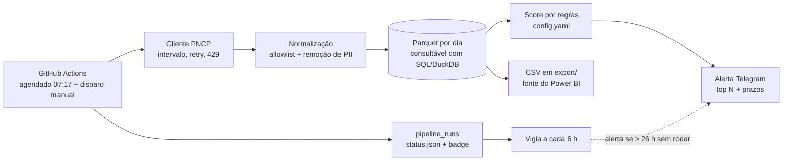

# Radar de Licitações PNCP

> Todo dia um robô lê as licitações novas do governo federal, separa as que combinam com a sua empresa e manda o resumo no seu Telegram. Para o setor de orçamentos de empresas de engenharia e manutenção, que hoje perde horas caçando editais em portais. Agendado para as 7h17; o GitHub tem entregado de 3 a 5,5 horas depois (veja [Confiabilidade](#confiabilidade)).

[](https://github.com/victor-ozores/Radar-PNCP/actions/workflows/ci.yml)
[](https://github.com/victor-ozores/Radar-PNCP/actions/workflows/daily.yml)


> **Status:** MVP em construção. O pipeline, os alertas e os testes funcionam e foram verificados contra a API real. As seções marcadas com **(a preencher)** dependem de semanas de execução agendada e ainda não têm evidência. Nada abaixo é número inventado.

## O problema

Desde a Lei 14.133/2021, o **PNCP** (Portal Nacional de Contratações Públicas) concentra as publicações de licitações do país. Mas ele **não avisa ninguém** por palavra-chave, região ou perfil. Quem faz orçamentos e propostas entra em vários portais todo dia, ou descobre o edital tarde, ou nunca.

## O que o Radar responde

*"Quais editais novos combinam com a gente hoje, e quais vencem esta semana?"*

Alerta **real**, entregue no Telegram em 19/10/2026 numa execução local (4 UFs × 4 modalidades, 909 editais lidos em 3 min 22 s). Aparece só o primeiro dos 10 itens; o print do agendamento automático entra quando ele estiver ativo:

```
📡 Radar PNCP · 19/10/2026
108 editais novos combinam com o perfil, entre 909 analisados. Os 10 de maior nota:

Nota 100 · Contratação de empresa especializada para a execução de obras de Pavimentação de vias urbanas em concreto betuminoso usinado a quente (CBUQ), com área total de…
🏛 MUNICIPIO DE CANDIDO DE ABREU · 📍 Cândido de Abreu / PR
💰 R$ 9,7 mi · ⏰ prazo 12/11 08:00 (em 24 dias)
🔗 PNCP · sistema de origem
```

## Como funciona



1. **Busca** as contratações publicadas nos últimos 3 dias (cobre fim de semana e cron atrasado) para as UFs e modalidades do `config.yaml`, e **também as alteradas** hoje e ontem (prazo prorrogado, suspensão, revogação), mesmo que tenham sido publicadas meses antes.
2. **Limpa** cada registro: guarda só os campos de uma lista permitida e remove CPF, e-mail e telefone do texto livre.
3. **Grava** em Parquet particionado por dia de publicação. Rodar duas vezes a mesma janela não muda nenhum byte.
4. **Pontua** de 0 a 100 com regras do `config.yaml` e explica o motivo de cada nota.
5. **Avisa** no Telegram: novos relevantes, os prazos que vencem em 2 a 7 dias (os que ainda dão tempo de montar proposta; ajustável em `alerta.prazo_minimo_dias`), e um aviso se alguma busca falhou.
6. **Se monitora**: cada execução vira uma linha em `pipeline_runs`; falha dispara alerta; um vigia confere se o robô rodou nas últimas 26 h.

## Mude o perfil sem mexer no código

Tudo que define "o que interessa" está no [`config.yaml`](config.yaml): UFs, modalidades, termos fortes, fracos e de exclusão, faixa de valor e quantos editais aparecem no resumo. O perfil que acompanha o repositório é **fictício** (construtora de médio porte, engenharia civil e manutenção predial, em SP/RJ/MG/PR).

## Como rodar

### No Windows (sua máquina)

```powershell
python -m venv .venv
.\.venv\Scripts\python.exe -m pip install -r requirements-dev.txt
.\.venv\Scripts\python.exe -m pip install -e . --no-deps
.\scripts\run_local.ps1 --dry-run     # prévia do alerta; não grava nem envia
```

Para receber o alerta no Telegram, siga o [checklist de configuração](docs/setup-checklist.md) (bot, `.env`, secrets).

### No GitHub Actions (automático)

1. Cadastre `TELEGRAM_BOT_TOKEN` e `TELEGRAM_CHAT_ID` em *Settings > Secrets and variables > Actions*.
2. Rode **Pipeline diário** uma vez com `modo = bootstrap`; depois ele roda sozinho todo dia (também dá para disparar à mão).

### Consultar os dados com SQL

```powershell
duckdb -c ".read queries/04_saude_do_pipeline.sql"
```

Há exemplos em [`queries/`](queries): editais abertos, volume por UF, qualidade dos dados e saúde do pipeline.

<details>
<summary><b>Detalhes técnicos</b></summary>

### Decisões de arquitetura

| Decisão | Por quê |
|---|---|
| **DuckDB + Parquet**, sem arquivo `.duckdb` | SQL de verdade, custo zero, sem servidor. Parquet determinístico: reexecutar sem mudança não gera blobs novos no git |
| **Dados na branch `data`**, código na `main` | A `main` fica limpa; a branch pode ser reescrita (squash) se crescer. Crescimento medido (21/10/2026): uma execução que lê novos **e** alterados mexe em ~60 partições antigas e faz um clone novo crescer ~2 MB (a mesma execução sem o filtro de encerrados: 4,4 MB). Se for ~1 a 2 MB por dia, são 400 a 700 MB por ano, perto dos 1 GB que o GitHub recomenda; por isso a squash anual está prevista e o crescimento real das execuções agendadas precisa ser acompanhado |
| **Intervalo de 4 s entre chamadas** + espera de 30/60/120 s no 429 | A API devolve 429 (corpo HTML) após ~8 a 10 chamadas rápidas; medido em 19/10/2026 |
| **Cliente isolado** em `pncp_client.py` | Só ele conhece URL e parâmetros; trocar de endpoint não espalha mudança |
| **Upsert por `numeroControlePNCP`** | Editais mudam de status (revogada, suspensa) e de prazo depois de publicados |
| **Consulta por data de atualização**, além da de publicação | Medido em 21/10/2026: ~1% dos editais com prazo em até 7 dias tinha sido prorrogado (por exemplo, de 22/10 para 10/12). Só a consulta por atualização traz de volta um edital publicado há meses; ela recuperou 7 de 8 desses casos. A execução registra quantos prazos e situações mudaram (`prazos_alterados`, `situacoes_alteradas`) |
| **Score por regras, explicável** | Cada nota vem com os motivos; dá para calibrar o perfil olhando o `--dry-run` |
| **Regra firme de compra e locação** | Uma penalidade não bastava: três termos fortes somam +70 e cobrem um -40. Se a primeira palavra-núcleo do texto pede aquisição, fornecimento ou locação, a nota é zero, com exceções (obra que cita material, "fornecimento e instalação", empreitada). Os casos reais ficam em `tests/fixtures/casos_reais_filtro.json` |
| **Erros do Telegram nunca vazam o token** | O token vai na URL da API; logs do `httpx` ficam em WARNING e as mensagens de erro passam por filtro |

### Indicadores

Tabela `pipeline_runs` (um registro por execução): início, fim, duração, status (`success`, `partial`, `failed`), janela, buscas feitas e falhas, chamadas à API, 429, linhas lidas/novas/atualizadas/inválidas, relevantes novos, UF divergente, redações de PII, avisos de qualidade, alerta enviado, tipo e mensagem do erro.

### Stack

Python 3.11+ (testes locais em 3.13; o CI usa 3.12 em Ubuntu e Windows), `httpx`, `duckdb`, `pydantic`, `pyyaml`, `pytest`, `ruff`. GitHub Actions para agendar e para o CI (Ubuntu e Windows). Telegram Bot API para alertas.

### Padrões adotados

* Pipeline **determinístico e idempotente** (rodar 2x dá o mesmo resultado, verificado por hash de arquivo nos testes).
* **Testes automatizados** do cliente (paginação, 204, 429, 5xx), da normalização, do score, do armazenamento, dos alertas e do pipeline ponta a ponta com a API simulada. Há teste de **ausência de CPF** nos dados gravados.
* **Fonte única de verdade**: o Parquet. Os CSVs de `export/` e o painel derivam dele.
* Segredos só em variáveis de ambiente / secrets; varredura com gitleaks no CI.

### Estrutura do repositório

```
config.yaml            perfil de interesse e parâmetros
src/radar/
  pncp_client.py       HTTP, paginação, intervalo, retry
  normalize.py         JSON bruto -> linha plana, allowlist, remoção de PII
  store.py             Parquet por dia + DuckDB, upsert idempotente
  scoring.py           score 0-100 com motivos
  alerts/              montagem das mensagens e envio ao Telegram
  audit.py             pipeline_runs, status.json, badge.json
  export.py            CSVs para o Power BI
  heartbeat.py         vigia de "não rodou"
  pipeline.py · cli.py orquestração e linha de comando
tests/                 pytest, com amostra real da API em tests/fixtures
queries/               exemplos de SQL
docs/                  setup, qualidade dos dados, metodologia de horas
.github/workflows/     daily.yml · heartbeat.yml · ci.yml
```

</details>

## Confiabilidade

* **Idempotência:** reexecutar a mesma janela não duplica nem altera dados (testado).
* **Falha parcial não derruba o dia:** se uma busca cai, as outras seguem; a execução fica `partial` e o alerta avisa quais buscas falharam.
* **Alerta de falha:** o workflow manda uma mensagem 🚨 com o link da execução. Se nem o pacote instalar, um `curl` de reserva avisa.
* **Heartbeat:** a cada 6 h um segundo workflow confere se houve execução bem-sucedida nas últimas 26 h.
* **Vigia externo:** ao fim de cada execução diária bem-sucedida o robô acessa um endereço do [Healthchecks.io](https://healthchecks.io) (plano gratuito). Se o aviso não chegar no prazo, o próprio serviço alerta, por fora do GitHub. Isso cobre o caso em que o agendador do GitHub para de funcionar e o heartbeat, que também é agendado, para junto.
* **Agendamento vivo:** o GitHub desativa workflows agendados de repositórios públicos sem atividade por 60 dias; cada execução reabilita os dois workflows pela API.
* **Evidência pública:** histórico de execuções na aba *Actions* e `pipeline_runs.csv` na branch `data`.

**Horário real (medido em 20/10/2026):** as 5 execuções agendadas do primeiro dia (1 do pipeline e 4 do vigia) começaram de **3 h 09 a 5 h 25 depois** do horário marcado. O pipeline marcado para 07:17 rodou às 12:06 e o alerta chegou às 12:09; nenhuma execução foi pulada. O GitHub documenta que agendamentos podem atrasar sob carga; não investiguei a causa. O Healthchecks.io avisou que o pipeline estava atrasado e se recuperou sozinho quando ele terminou, o que mostra que o vigia externo funciona, mas também que a folga dele (*Grace Time*) precisa ser maior que o atraso observado.

**(a preencher)** Taxa de sucesso e distribuição do atraso após algumas semanas de execução agendada. Por ora são só 5 observações.

## Custos: por que roda de graça

| Peça | Custo | Cuidado tomado |
|---|---|---|
| GitHub Actions em repositório público | R$ 0 | Sem limite de minutos em repositório público. A execução diária faz ~145 chamadas ao PNCP: de 12 a 30 minutos, conforme a velocidade da API (de 5 a 12 s por chamada nos testes de 21/10/2026); o limite do workflow é 60 |
| API do PNCP | R$ 0 | Pública e sem login |
| Telegram Bot API | R$ 0 | Sem cartão |
| Healthchecks.io (vigia externo) | R$ 0 | Plano gratuito; usa 1 dos 20 checks. Sem recursos pagos (SMS, ligação) |
| Armazenamento (Parquet no git) | R$ 0 | Sem banco hospedado; evita serviços que pausam por inatividade |

Armadilhas evitadas de propósito: serviços que exigem cartão, bancos gratuitos que pausam por inatividade e agendadores pagos.

## Dados e LGPD

* A fonte é sobre **órgãos públicos e contratações**, não sobre pessoas.
* A normalização usa **lista de campos permitidos**: tudo que não está na lista é descartado, inclusive `usuarioNome` (quem cadastrou a compra no sistema de origem).
* No texto livre (`objetoCompra`, `informacaoComplementar`, `processo`), **CPF, e-mail e telefone são substituídos** por marcadores, e a quantidade vai para `pipeline_runs.pii_redactions`. E-mails são removidos mesmo quando parecem institucionais, porque o código não consegue distinguir.
* Há teste automatizado garantindo que nenhum CPF chega ao Parquet nem ao CSV.

## Resultados

**(a preencher)** Os números abaixo só entram depois de semanas de execução agendada:

* execuções agendadas e taxa de sucesso;
* editais lidos, novos e relevantes por mês;
* frescor (horário do alerta menos publicação no PNCP);
* precisão do filtro numa amostra revisada à mão.

**Horas economizadas** são sempre uma **estimativa**, com fórmula e premissas explícitas e ainda não validadas em [`docs/metodologia-horas.md`](docs/metodologia-horas.md).

## Achados sobre os dados do PNCP

Resumo em [`docs/qualidade-dados-pncp.md`](docs/qualidade-dados-pncp.md): a API não exige login, mas bloqueia com HTTP 429 (corpo HTML) quem consulta rápido; "sem valor" chega como zero; "mão de obra" nos textos faz uma busca ingênua por "obra" marcar serviços de limpeza e vigilância como obras.

## Painel Power BI

**(a preencher)** Dois painéis planejados: negócio (editais por UF, modalidade e órgão; valor estimado; prazos da semana; funil encontrados > relevantes) e saúde do pipeline. Plano B, se o Power BI Service não permitir atualização agendada ou publicação na web com a conta disponível: `.pbix` no repositório, prints e um GIF.

## Uso de IA

Este projeto foi construído com o **Claude Code**. A divisão de papéis:

* **Autor (Victor):** definiu o problema, o público, as restrições (custo zero, repositório público, LGPD, Windows), o perfil de interesse e o que conta como sucesso; revisa e valida o que for publicado.
* **Claude Code:** propôs a arquitetura, escreveu o código e os testes, e validou o comportamento da API com chamadas reais, registrando o que encontrou em [`docs/qualidade-dados-pncp.md`](docs/qualidade-dados-pncp.md).

O score **não usa IA**: é um conjunto de regras determinísticas e auditáveis. Uma camada opcional de classificação com LLM de cota gratuita, com retorno obrigatório às regras se a cota acabar, está prevista, não implementada.

## Limitações conhecidas

* O perfil de interesse é fictício; os termos ainda não foram calibrados com uma pessoa de orçamentos.
* O score olha só o objeto da compra. Editais com descrição genérica ("serviços diversos") podem escapar.
* O filtro por UF usa a UF do órgão; o local de execução da obra pode ser outro.
* Dispensas de licitação (modalidade 8) e outras modalidades ficam fora até o volume ser medido.
* O cron do GitHub atrasa: na primeira execução agendada o resumo chegou 4 h 49 min depois das 07:17. O heartbeat cobre execuções que não aconteceram, não atrasos. A folga do vigia externo é configurada no site (*Grace Time*) e precisa ficar acima do atraso observado.
* O filtro é um perfil de **palavras e valores**, não entende o sentido do texto. Numa amostra independente de 40 editais relevantes (21/10/2026), 39 estavam claramente certos e 1 era duvidoso, mas é amostra pequena e o rótulo é um julgamento (de Claude), ainda não revisado por quem faz orçamentos. A faixa de nota 40 a 59 é mais ruidosa (~75% corretos numa amostra anterior).
* O que o filtro **deixa de fora**: obras pequenas (abaixo de R$ 100 mil) e muito grandes (acima de R$ 20 mi), por desenho do perfil; e assuntos cujas palavras também aparecem fora de obra, como "ponte" (a cidade Ponte Nova), "drenagem" (cânula de drenagem venosa) e "esgotamento sanitário" (software e planos). Foram testados e rejeitados por trazer lixo.
* Quando o nome da secretaria que pediu a compra traz "Obras" ou "Engenharia" dentro do texto, um serviço sem relação (por exemplo, alinhamento e balanceamento de veículos) ainda pode passar. Ignorar esse trecho foi testado e tirava obra de verdade (muro de arrimo, manutenção de ar condicionado), então não foi adotado.
* A regra de compra mantém como serviço "fornecimento e instalação de..." (geradores, peças), que pode ser equipamento. É uma escolha, e vale revisar.
* A consulta por atualização lê as alterações de **hoje e de ontem** (`ingestao.lookback_atualizacao_dias`, e o período informado no `backfill`). Se o robô ficar mais de 1 dia parado, prorrogações desse intervalo só voltam com um `backfill`. Ela ignora alterações de editais que já estavam encerrados (homologações de processos antigos), que eram a maior parte das linhas. Medido: 1 de 8 editais com prazo alterado não apareceu na consulta (também sumiu da consulta individual do PNCP; causa desconhecida).
* E-mail diário, painel Power BI e registro no Agendador de Tarefas do Windows ainda não foram implementados.

## Licença

[MIT](LICENSE). Autor: Victor Amorim Ozores.
